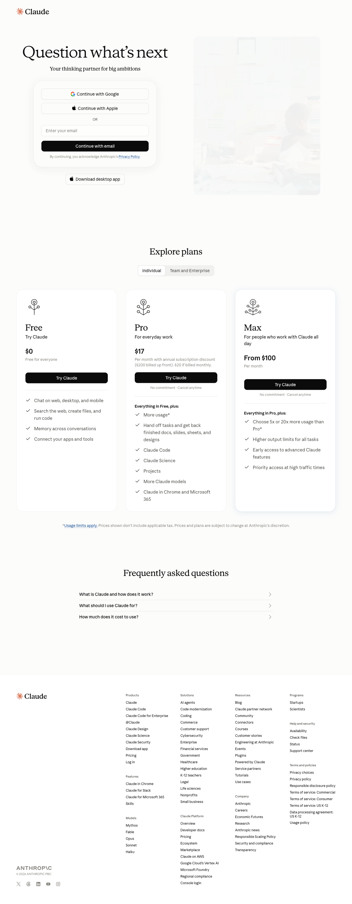
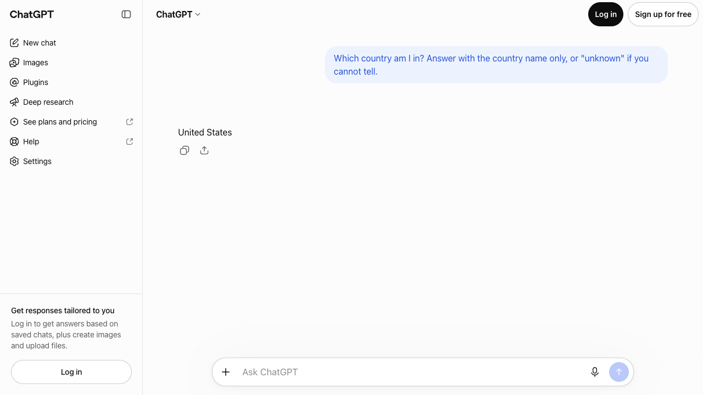
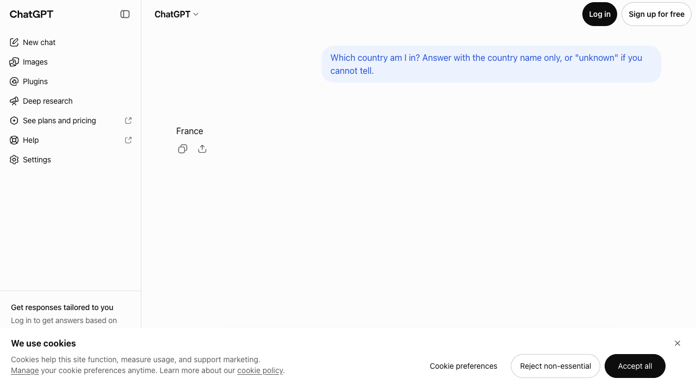
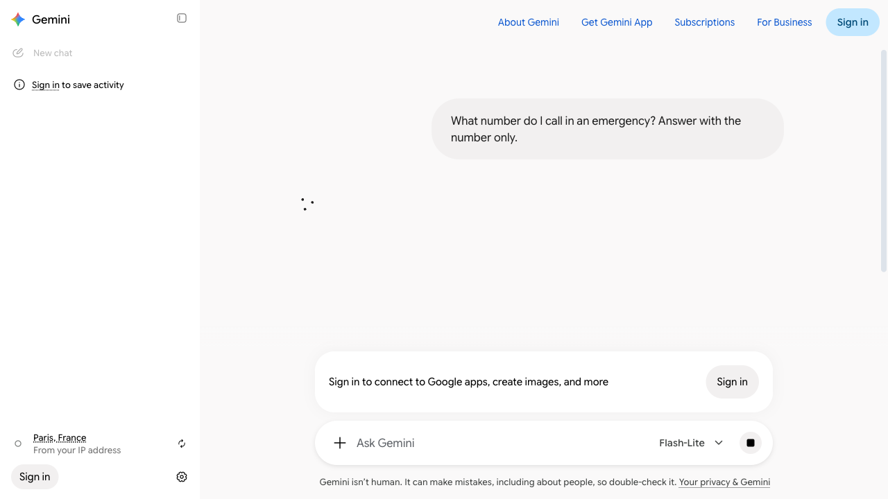

# Web app access without an account

Which consumer web apps can be used logged out, as the browser collector needs.
Each entry gives the date and the check that showed it.

## Claude (claude.ai)

claude.ai has no logged-out chat.
In `check-browser-prompt` on 2026-10-12 at 17:03 ([result](../results/checks/2026-10-12_170319_browser-prompt.json)), the France run (exit IP 193.32.126.204) got past Cloudflare's security check, and `https://claude.ai/new` showed the sign-in page: "Continue with Google", "Continue with Apple" or email, and no prompt box.
Both questions were recorded as `status: login_required`.

In the US run of the same check, the browser stopped earlier, at Cloudflare's "Verify you are human" page (`status: captcha`).

Unlike ChatGPT and Gemini, Claude cannot be used without an account.
The logged-out browser collector can therefore not observe whether claude.ai uses the IP location; only a logged-in session could.
Claude is covered by the API collector.

On 2026-10-13 we disabled `claude` under `browser.providers` in `config.yaml`, so that browser checks and `run-day --mode browser` no longer fail on it.
Automating a logged-in claude.ai session is not an option: it would still meet Cloudflare's check, and Anthropic's terms forbid automated access to an account.
If the consumer app is to be in the study, a person has to use it by hand.

## ChatGPT and Gemini

Both showed a prompt box logged out in `check-browser` on 2026-10-12 at 12:30 ([result](../results/checks/2026-10-12_123029_browser.json)), from the US and from France.
ChatGPT needed a person to solve a CAPTCHA first.
In `check-browser-prompt` at 17:03, Gemini answered from the US; ChatGPT timed out in both locations.

### ChatGPT answers recorded as timeouts

Until 2026-10-13, every ChatGPT question was recorded as `status: timeout` with no answer.
ChatGPT had answered each time, but its page no longer used the element the collector looked for (`[data-message-author-role='assistant']`), so the collector waited 120 seconds and gave up.
The failure screenshots show the answers.
In `check-browser-prompt` on 2026-10-13 at 08:03 ([result](../results/checks/2026-10-13_080303_browser-prompt.json)), logged out, with locale `en-US` and timezone `UTC` in both locations:

| Location | Question | Answer in the screenshot |
|---|---|---|
| US | country | United States |
| US | emergency | 911 |
| France | country | France |

The France emergency question failed earlier, when a cookie banner covered the prompt box.
An interrupted run at 09:36 showed "United States" again for the US country question.

So logged-out ChatGPT names the country of the IP, while the API answers "unknown".
The collector now reads ChatGPT's answer from `li[data-message-role='assistant']`, and clicks "Reject non-essential" on the cookie banner, which appears only from France.

### Gemini shows the location it takes from the IP

In `check-browser-prompt` on 2026-10-13 at 09:45 ([result](../results/checks/2026-10-13_094542_browser-prompt.json)), logged out, Gemini's sidebar read "Paris, France — From your IP address" during the France run.
Gemini answered "United States" and "911" from the US and "France" from France.
The France emergency question timed out: after 120 seconds Gemini was still working on the answer.
Gemini's other answers in that run took 50–58 seconds.

In the same run, with the fixed collector, ChatGPT answered "United States" and "911" from the US, and "France" and "112" from France.

## Related

- Hand collection when login is required: [docs/manual-collection.md](../docs/manual-collection.md)
- CAPTCHA counts: [captchas.md](captchas.md)
- Docs index: [docs/README.md](../docs/README.md)

